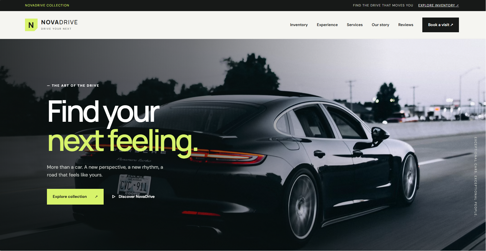
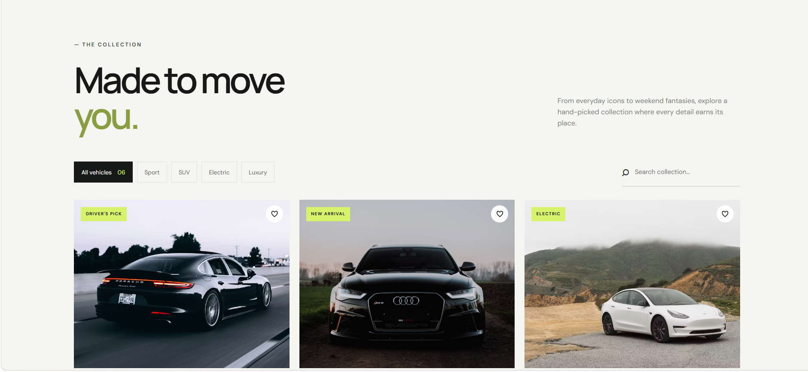
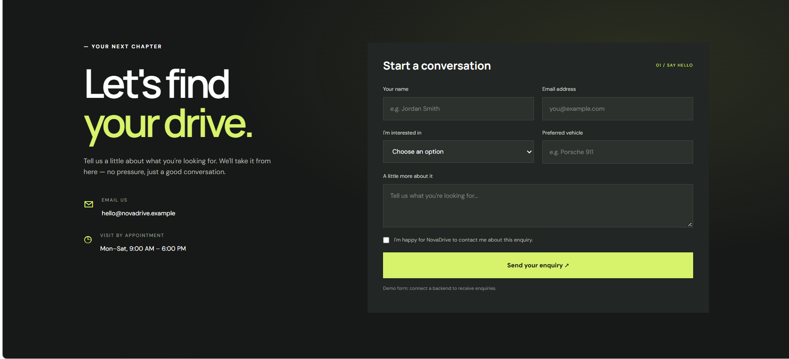

# 🚗 NovaDrive — Automotive Showcase

A modern, interactive automotive showcase website designed to deliver a premium vehicle browsing experience with elegant UI, responsive layouts, and engaging interactions.

<p align="center">
  <b>Discover. Explore. Drive.</b>
</p>

---

## ✨ Overview

NovaDrive is a frontend automotive website project built to showcase vehicles through a modern, visually engaging interface. It combines automotive-inspired styling with interactive components and responsive web design.

## 🚀 Features

- Modern automotive-inspired interface
- Responsive website layout
- Interactive vehicle browsing experience
- Vehicle search and filtering
- Dynamic UI interactions
- Clean and organized frontend structure

## 🛠️ Tech Stack

| Technology | Purpose |
|---|---|
| HTML5 | Website structure |
| CSS3 | Styling, layout and animations |
| JavaScript | Interactive functionality |

## 📂 Project Structure

```text
NovaDrive/
├── index.html
├── style.css
├── script.js
└── README.md
```

## ⚙️ Getting Started

### 1. Clone the repository

```bash
git clone https://github.com/VfFayas-hidden/NovaDrive.git
```

### 2. Open the project

Navigate into the project folder.

### 3. Run the website

Open `index.html` in your browser or use the VS Code Live Server extension.

## 🎯 Project Goals

- Practice modern frontend development
- Improve JavaScript interaction skills
- Create visually engaging web interfaces
- Develop responsive website layouts
- Build practical portfolio projects

## 🔮 Future Improvements

- Add more vehicle details
- Improve animations and transitions
- Enhance mobile experience
- Add additional interactive features

## 👨‍💻 Author

**Mohammed Fayas**

Frontend Developer | BCA Student

## Preview

### Homepage


### Vehicle Collection


### Contact Section


- GitHub: [@VfFayas-hidden](https://github.com/VfFayas-hidden)
- LinkedIn: [Connect with me](https://www.linkedin.com/in/v-f-mohammed-fayas/)

---

<p align="center">
  <i>Built with passion for design and web development.</i>
</p>
